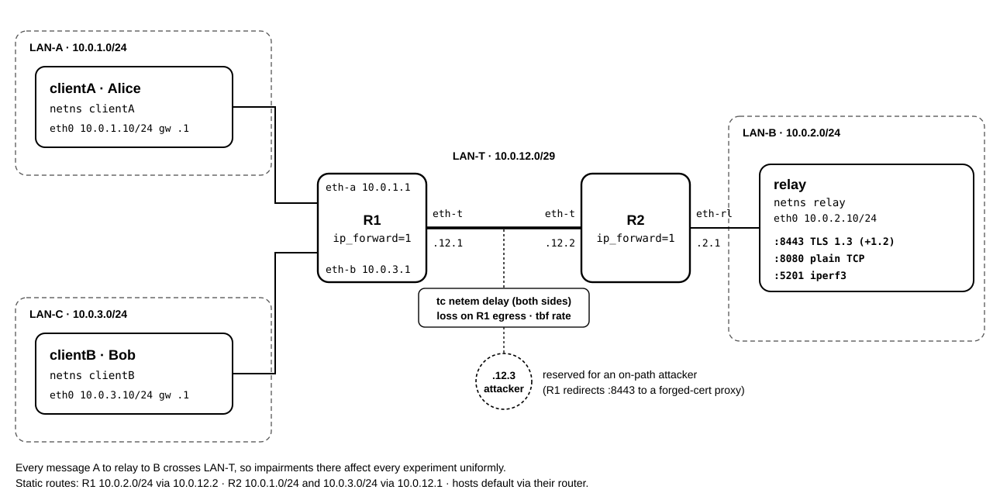

# Secure Messaging over TLS 1.3 with End-to-End Encryption

**Handshake and overhead analysis on a routed topology** · Computer Networks, Project #2 · Group F, BCS 5H

A small secure chat system (Client A ↔ relay ↔ Client B) that is protected twice: **TLS 1.3** on every hop and
**NaCl Box (X25519 + XSalsa20-Poly1305) end-to-end** between the two users, so the relay only ever forwards ciphertext.
It runs across a routed Linux network (5 network namespaces, 2 routers, 4 subnets, static routes) where delay and loss are
injected with `tc netem`, and ends in **measured** handshake time, round trips, byte overhead and message latency,
backed by packet captures.



| | |
|---|---|
| Protocols | TCP, TLS 1.3 (TLS 1.2 for comparison), X25519 / XSalsa20-Poly1305 |
| Stack | Python 3 (`ssl`, PyNaCl), `ip netns`, `tc netem/tbf`, tcpdump, Wireshark |
| Metrics | TCP + TLS handshake time, RTTs to first data, byte overhead by layer, message latency |
| Conditions | RTT 20 / 100 / 200 ms at 0 % loss; ~20 ms RTT at 0 / 2 / 5 % loss; 5 runs each |
| Zero cost | No cloud, accounts, API keys or paid software |

## 1. Try it in two minutes (any OS)

```bash
pip install -r requirements.txt          # PyNaCl (+ matplotlib for the plots); needs the `openssl` CLI for certificates
python3 ui/server.py --open              # dashboard on http://127.0.0.1:8088
python3 -m unittest discover -s tests    # 15 tests: TLS, E2EE, resumption, attacks, capture analysis
python3 -m attacks.demo_attacks          # the security demonstrations, as a text report
```

The **dashboard** runs the real relay and two real clients in one process and lets you switch between plain TCP, TLS 1.3
and TLS 1.3 + E2EE while watching what a network eavesdropper and the relay itself can see. It also shows the topology,
the experiment results with charts, an attack lab, and the evidence checklist.

Plain command-line chat (three terminals):

```bash
python3 certs_tool.py
python3 relay.py --tls                       # TLS 1.3 relay on 127.0.0.1:8443
python3 client.py alice --mode e2ee          # then:  bob: hello
python3 client.py bob   --mode e2ee
```

Modes: `--mode tcp` (baseline, relay started *without* `--tls`), `--mode tls` (hop security only), `--mode e2ee` (the real system).
Pin a fingerprint you checked out-of-band with `--trust "bob=ab12 cd34 …"`.

## 2. Reproduce everything on Linux (the graded environment)

Needs Ubuntu 20.04 / 22.04 / 24.04 (native, VirtualBox, or the official Mininet VM image), root, and **not** WSL2
(its default kernel lacks the `netem` module).

```bash
sudo apt update
sudo apt install -y python3-pip openssl iproute2 iputils-ping traceroute tcpdump iperf3 tshark iptables
pip3 install -r requirements.txt
git clone https://github.com/msaadsohail05/CN_Project_TLS_Secure_Messaging && cd CN_Project_TLS_Secure_Messaging

sudo bash scripts/run_all.sh            # everything below, in order (add --quick for a ~10 min smoke run)
```

`run_all.sh` does, and you can run each step on its own:

| Step | Command | Produces |
|---|---|---|
| 1 certificates | `python3 certs_tool.py` (or `bash gen_certs.sh`) | `certs/` private CA + relay cert with SAN `IP:10.0.2.10`, plus `certs/rogue/` for the attack demos |
| 2 topology | `sudo bash topology.sh up` | 5 namespaces, veth links, forwarding, static routes (`down` / `status` also available) |
| 3 routing proof | `sudo ip netns exec clientA traceroute -n 10.0.2.10` | `evidence/routing_tables.txt`, traceroute: `10.0.1.1 → 10.0.12.2 → 10.0.2.10` |
| 4 tests | `python3 -m unittest discover -s tests` | 15 passing tests |
| 5 captures | `sudo bash scripts/capture_evidence.sh` | the 9 required `.pcapng` files + TLS key logs in `evidence/captures/` |
| 6 attacks | `sudo bash scripts/attack_demo.sh all` | forged-certificate and key-substitution demos, logs in `evidence/` |
| 7 experiments | `sudo python3 -m bench.run_experiments --env netns` | `results/raw/*.csv`, `results/summary.json` |
| 8 figures + overhead | `python3 -m bench.plots` · `python3 -m bench.analyze_overhead FILE.pcapng` | `results/plots/*.png`, layered byte accounting |
| dashboard | `python3 ui/server.py` | everything above, browsable |

Open any capture in Wireshark, then *Edit → Preferences → Protocols → TLS → (Pre)-Master-Secret log filename* and point it
at the `.keylog` file with the same name to decrypt TLS 1.3. Walk through the 5-minute demo with [docs/DEMO_SCRIPT.md](docs/DEMO_SCRIPT.md).

### Experiment design (what `bench.run_experiments` does)

For each condition it applies the impairment on the R1–R2 link (`scripts/impair.sh`), **verifies it independently with ping**
(configured vs measured RTT and loss are stored in `results/raw/verify_*.json`), then runs:

* **Handshake matrix** (`bench/exp_handshake.py`): per run, 20 sequential connections for each of plain TCP, TLS 1.2, TLS 1.3 and TLS 1.3 *resumed* (one priming connection first); configuration order shuffled every run; failures recorded, never dropped.
* **Latency matrix** (`bench/msgbench.py`): per run, 100 messages A → relay → B for each of {plain TCP, TLS only, TLS + E2EE} × {64 B, 1 KiB, 16 KiB}; timestamp taken before encryption and after decryption on the shared host clock.
* **Aggregation** (`bench/aggregate.py`): metrics are averaged within each run, then mean and standard deviation are taken **across the 5 runs**; min / median / p95 / max stay visible so outliers (e.g. a lost SYN costing a ~1 s retransmit) are explained rather than hidden.

| Set | RTT | Loss |
|---|---|---|
| A-1 / B-1 | 20 ms | 0 % |
| A-2 | 100 ms | 0 % |
| A-3 | 200 ms | 0 % |
| B-2 | 20 ms | 2 % |
| B-3 | 20 ms | 5 % |

Delay is split evenly over both router-side interfaces of the link; loss is applied in **one direction only** (R1 egress), so the nominal 2 % / 5 % is what each packet in that direction experiences and the condition stays interpretable.

## 3. Repository map

```
relay.py  client.py  protocol.py  keystore.py   the messaging system (stages 3, 5, 6, 7, 11)
tlsutil.py                                       TLS contexts, timed connect, thread-safe TLS socket
certs_tool.py  gen_certs.sh                      private CA + relay certificate
topology.sh                                      namespace topology (stages 1, 4)
tap.py                                           passive on-path observer (what a sniffer can parse)
scripts/   impair.sh capture.sh capture_evidence.sh attack_demo.sh run_all.sh
bench/     exp_handshake  msgbench  run_experiments  aggregate  plots  pcap  analyze_overhead  probe  conditions
attacks/   demo_attacks  tls_mitm  evil_relay      security demonstrations
ui/        server.py lab.py static/                the dashboard
tests/     test_core  test_analysis                15 tests
docs/      REPORT.md ARCHITECTURE.md DEMO_SCRIPT.md AI_USE_DISCLOSURE.md architecture.svg
evidence/  routing_tables.txt  captures/           proof artefacts
results/   raw/ summary.json plots/                measured data
```

### Stage map (from the proposal)

| # | Stage | Where |
|---|---|---|
| 1 | Namespace topology | `topology.sh up` |
| 2 | Certificates + TLS 1.3 echo | `gen_certs.sh`, `echo_server.py`, `echo_client.py` |
| 3 | Wire protocol + plain TCP relay | `protocol.py`, `relay.py` |
| 4 | Static routing, traceroute | `topology.sh`, `evidence/routing_tables.txt` |
| 5 | TLS 1.3 relay, concurrent clients, wrong-CA refusal | `relay.py` (`Relay._handle`), `tlsutil.py` |
| 6 | X25519 keys + public-key directory | `keystore.py`, PUBLISH / LOOKUP frames |
| 7 | End-to-end encryption (NaCl Box), tamper rejection | `client.py` |
| 8 | Session resumption + TLS 1.2 switch | `tlsutil.timed_connect(session=…)`, `bench/exp_handshake.py`, `relay.py --allow-tls12` / `--tls-version 1.2` |
| 9 | Capture pipeline, key logging | `scripts/capture.sh`, `scripts/capture_evidence.sh`, `--keylog` flags |
| 10 | Impairment scripts (netem / tbf) | `scripts/impair.sh` |
| 11 | Operating modes + fingerprint display / pinning | `client.py --mode`, `--trust` |
| 12 | Timing instrumentation → CSV | `tlsutil.timed_connect`, `bench/*.py` |
| 13 | Handshake experiment runner | `bench/exp_handshake.py` |
| 14 | Message-latency runner | `bench/msgbench.py` |
| 15 | Layered byte-overhead analysis | `bench/analyze_overhead.py`, `bench/pcap.py` |
| 16 | Run all experiments, tables, plots | `bench/run_experiments.py`, `bench/aggregate.py`, `bench/plots.py` |
| 17 | Attack demonstrations | `attacks/`, `scripts/attack_demo.sh` |
| 18 | README, demo script, integration | this file, `docs/DEMO_SCRIPT.md`, `scripts/run_all.sh`, `ui/` |

## 4. Design notes and known limits

* **TLS 1.3 resumption does not save a round trip.** A PSK-resumed handshake is still 1 RTT, like a full one; it saves *bytes* (no Certificate / CertificateVerify) and CPU. Only 0-RTT early data removes the round trip, and Python's `ssl` cannot send it, so 0-RTT is explicitly out of scope. Our measurements show exactly this.
* **Resumption needs the same `SSLContext` object and a post-handshake round trip.** The `NewSessionTicket` arrives *after* the handshake, so the client does one application round trip before reading `.session`, and reuses one context for the resumed connections (otherwise Python raises `Session refers to a different SSLContext`). `bench/probe.py resumed` fails loudly if the session was not actually resumed.
* **The certificate carries an IP SAN** (`IP:10.0.2.10`) because clients connect by address, and CA certificates carry `basicConstraints` + `keyUsage` (Python ≥ 3.13 verifies in strict mode and rejects CAs without them).
* **TLS sockets are wrapped in `tlsutil.SafeTLS`.** The relay and clients read on one thread while others send; a blocking `SSLSocket` is not safe for that (a read can process a TLS 1.3 post-handshake message mid-write). The wrapper serialises each SSL call under a lock and waits for readiness outside it.
* **E2EE overhead is a fixed 40 bytes** (24 B nonce + 16 B MAC), so it is proportionally huge for tiny messages and negligible for large ones; it does not change with network conditions. The total wire overhead is larger than E2EE + TLS record overhead because TCP/IP headers, ACKs and segmentation add on top.
* **Replay is out of scope.** NaCl `Box` authenticates and encrypts but does not order messages; a captured message can be replayed to the same recipient. A per-sender sequence number inside the plaintext would close this (at +8 B per message).
* **Trust model.** The relay is the directory for public keys, so a dishonest relay can substitute keys. Out-of-band fingerprint comparison (`--trust`, or the dashboard's pin toggle) defends against it, as the attack lab demonstrates.
* **Latency includes crypto.** Each message is timestamped before encryption and the receive time is taken after decryption, so the E2EE column reports the real end-to-end cost.
* **Measured results.** `results/` and `evidence/` hold the full run produced by `scripts/run_all.sh` on an Ubuntu 24.04 VM (5 conditions × 5 runs; configured vs measured RTT / loss are in `results/raw/verify_*.json`). `--env local` is only a laptop smoke test.

## 5. Troubleshooting

| Symptom | Fix |
|---|---|
| `RTNETLINK answers: File exists` building the topology | use the repo's `topology.sh` (veth pairs are created with temporary names, then moved and renamed) |
| client prints `certificate verify failed` | regenerate certs with `python3 certs_tool.py`; connect to `10.0.2.10` or `127.0.0.1` (the SANs), not another address |
| `NTP not supported` / drifting VM clock | `sudo apt install -y chrony && sudo chronyc makestep` — latency numbers and capture timestamps depend on a stable clock |
| `tc: Unknown qdisc "netem"` | the kernel lacks `sch_netem` (common on WSL2); use a VM or native Ubuntu, `sudo modprobe sch_netem` |
| a resumed handshake reports `resumed=False` | the ticket had not arrived: do one application round trip first, and use the same `SSLContext` |
| `name taken` right after restarting a client | the relay has not noticed the old connection closing yet; wait a second |
| leftover namespaces after a crash | `sudo bash topology.sh down` |

## 6. Team

Group F · BCS 5H — Saad Soail (24K-0549) · Taha Anwar (24K-3033) · Muhammad Abdullah (24K-0977)
Tracks: **N** Network / experiments — Abdullah · **S** Server / transport security — Saad · **C** Client / E2EE — Taha.
AI-tool use is disclosed in [docs/AI_USE_DISCLOSURE.md](docs/AI_USE_DISCLOSURE.md).
