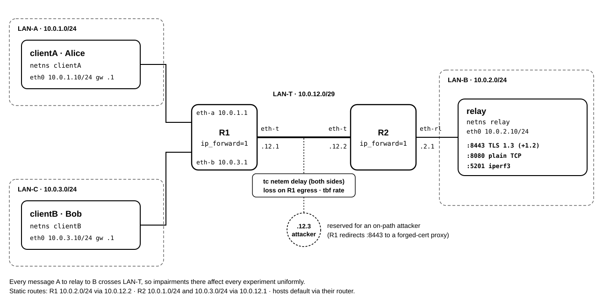

# Architecture



## Subnets and addressing (corrected labels, matching the diagram)

| Label | Purpose | Prefix | Addresses |
|---|---|---|---|
| LAN-A | Client A (Alice) | 10.0.1.0/24 | clientA `.10` (eth0), R1 `.1` (eth-a) |
| LAN-B | Relay | 10.0.2.0/24 | relay `.10` (eth0), R2 `.1` (eth-rl) |
| LAN-C | Client B (Bob) | 10.0.3.0/24 | clientB `.10` (eth0), R1 `.1` (eth-b) |
| LAN-T | R1–R2 transit (impairments live here) | 10.0.12.0/29 | R1 `.1`, R2 `.2` (eth-t), `.3` reserved for an on-path attacker |

2 routers and 4 subnets exceed the baseline (≥ 2 routers, ≥ 3 subnets). Routing is static: each host's default gateway is its own router;
R1 routes `10.0.2.0/24` via `10.0.12.2`; R2 routes `10.0.1.0/24` and `10.0.3.0/24` via `10.0.12.1`.
`traceroute -n 10.0.2.10` from clientA shows exactly two intermediate hops: `10.0.1.1 → 10.0.12.2 → 10.0.2.10`.

## Ports

| Port | Protocol | Purpose |
|---|---|---|
| 8443/tcp | TLS 1.3 (TLS 1.2 allowed with `--allow-tls12`) | the relay's secure service |
| 8080/tcp | plain TCP | baseline mode, measurement comparison only |
| 5201/tcp | iperf3 | sanity-checking link delay / bandwidth, not part of the application |

## Components

```
           Alice (clientA)                                         Bob (clientB)
   ┌─────────────────────────┐                             ┌─────────────────────────┐
   │ client.py               │                             │ client.py               │
   │  X25519 keypair (keys/) │                             │  X25519 keypair (keys/) │
   │  NaCl Box seal / open   │                             │  NaCl Box seal / open   │
   └───────────┬─────────────┘                             └───────────┬─────────────┘
               │  TLS 1.3 (hop 1)                                      │  TLS 1.3 (hop 2)
               ▼                                                       ▼
          R1 ── LAN-T (tc netem / tbf) ── R2 ──────────► relay.py (clients{}, pubkeys{})
                                                          forwards MESSAGE frames by recipient,
                                                          never decrypts the E2EE body
```

* **TLS protects the hop, E2EE protects the content.** Anyone sniffing a link sees only TLS records; the relay is a legitimate TLS endpoint, so without E2EE it would read every message.
* **Relay (`relay.py`)** keeps `username → connection` and `username → X25519 public key`. One thread per client; the TLS handshake runs in that thread so a stalled client cannot block the accept loop. Each connection has its own send lock.
* **Client (`client.py`)** generates an X25519 key pair on first run, registers, publishes its public key, looks peers up through the relay, and seals every message with `nacl.public.Box`. The *first* key seen for a peer is kept; a changed key is reported. A fingerprint (first 16 bytes of SHA-256, shown as 8 groups of 4 hex digits) can be pinned.

## Wire protocol (binary, fixed-width)

```
[4-byte length][1-byte type][payload]
types: 1 REGISTER  2 LOOKUP  3 MESSAGE  4 ERROR  5 PUBLISH
REGISTER  payload = username
PUBLISH   payload = 32-byte X25519 public key
LOOKUP    request = username;  reply = [name-len][name][0x01 + 32-byte key  |  0x00]
MESSAGE   payload = [name-len][recipient name][body]      (relay rewrites the name to the sender)
          body = plaintext (tcp/tls modes) or nonce(24) + ciphertext + MAC(16) (e2ee mode)
```

The framing is deliberately fixed-width so the layered byte accounting is exact: per message the application adds `4 + 1 + 1 + len(name)` bytes of framing,
E2EE adds 40 bytes, a TLS 1.3 application record adds 22 bytes (5 header + 1 inner content type + 16 AEAD tag), TCP/IP headers add 40 more per segment.

## Operating modes (one code path)

| Mode | Transport | App payload | Relay sees |
|---|---|---|---|
| `tcp` | plain TCP :8080 | plaintext | everything |
| `tls` | TLS 1.3 :8443 | plaintext | everything (TLS ends at the relay) |
| `e2ee` | TLS 1.3 :8443 | NaCl Box ciphertext | frame metadata and ciphertext only |

## Measurement architecture

```
bench.run_experiments (root, host namespace)
   ├─ scripts/impair.sh        tc netem on r1:eth-t and r2:eth-t (delay both sides, loss on r1 egress)
   ├─ ping verification        configured vs measured RTT / loss → results/raw/verify_*.json
   ├─ ip netns exec clientA    bench.exp_handshake  → results/raw/handshake_<cond>.csv
   ├─ ip netns exec clientB    bench.msgbench recv  ┐
   ├─ ip netns exec clientA    bench.msgbench send  ┴→ results/raw/latency_<cond>.csv
   └─ bench.aggregate          → results/summary.json (+ CSV tables) → bench.plots / dashboard
captures: scripts/capture.sh (tcpdump in a namespace) → evidence/captures/*.pcapng → bench.analyze_overhead
```
