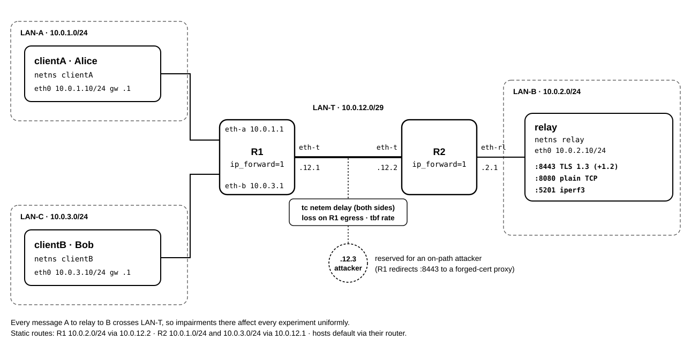

# Secure Messaging over TLS 1.3 with End-to-End Encryption: Handshake and Overhead Analysis

**Group F · BCS 5H** — Saad Soail (24K-0549), Taha Anwar (24K-3033), Muhammad Abdullah (24K-0977)
Computer Networks · Project #2 · November 2026

> Measured results are in §6-§7 (from `results/` and `evidence/captures/`, produced by `scripts/run_all.sh`). Section authorship follows the tracks: §3.1, §5, §6 Abdullah (N) · §2.2, §3.2, §7 Saad (S) · §3.3, §8 Taha (C). Re-run `python3 -m bench.report_tables` after any new experiment run.

## Abstract

We build a small secure messaging system (two clients and a relay) and measure what each security layer costs. Every connection is protected by
TLS 1.3 hop-by-hop, and messages are additionally sealed end-to-end with NaCl `Box` (X25519 + XSalsa20-Poly1305), so the relay forwards only
ciphertext. The system runs across a routed topology of five Linux network namespaces (two routers, four subnets, static routes) where delay and
loss are injected on the router link with `tc netem`. We compare plain TCP, TLS 1.2, TLS 1.3 (full and resumed) and TLS 1.3 + E2EE on handshake
time, round trips, byte overhead and end-to-end message latency under five network conditions with five runs each, backed by packet captures, and we demonstrate
the defences against a forged certificate, a malicious relay substituting public keys, and ciphertext tampering.

## 1. Introduction and objectives

Transport security (TLS) protects a connection between two endpoints, but in a messaging service the relay is itself an endpoint, so TLS alone does not
keep messages from the service. End-to-end encryption (E2EE) removes the relay from the trust base for message content. We therefore ask:

1. **Round trips.** How many round trips does a TLS 1.3 handshake need compared with TLS 1.2, and does session resumption change that?
2. **Bytes.** How many extra bytes does each layer (TLS records, E2EE, our framing, TCP/IP) add, and how does that depend on message size?
3. **Latency.** What do TLS and E2EE add to end-to-end message latency, and how do delay and loss change it?
4. **Security.** Which attacks does each layer stop, and what remains (key substitution, replay)?

**Hypotheses** (stated before measuring; the proposal's resumption claim was corrected, see §3.2):
(H1) TLS 1.3 completes its handshake in one RTT after TCP; TLS 1.2 needs two. (H2) A resumed TLS 1.3 handshake needs the **same** one RTT but fewer bytes and less time
(no certificate exchange or signature) — only 0-RTT early data would remove the round trip, and Python's `ssl` cannot send it, so 0-RTT is out of scope.
(H3) The E2EE overhead is a fixed 40 bytes, proportionally large for small messages and negligible for large ones. (H4) Total wire overhead exceeds
E2EE + TLS-record overhead because TCP/IP headers, ACKs and segmentation add on top. (H5) Loss increases variance and produces explainable outliers (retransmission timeouts).
(H6) The cost of encryption is small relative to network delay at these RTTs — to be measured, not assumed.

## 2. Background

### 2.1 Handshakes and round trips (after the TCP 3-way handshake, ≈ 1 RTT)

| Handshake | Round trips | Flights |
|---|---|---|
| TLS 1.2 full | 2 | ClientHello → ServerHello + Certificate + ServerHelloDone → ClientKeyExchange + Finished → Finished |
| TLS 1.3 full | 1 | ClientHello + key_share → ServerHello + {Certificate, CertificateVerify, Finished} → Finished |
| TLS 1.3 resumed (PSK) | 1 | ClientHello + PSK → ServerHello + {Finished} (no certificate) → Finished — same RTT count, fewer bytes |
| TLS 1.3 + 0-RTT | ≈ 0 | application data in the first flight (out of scope) |

In TLS 1.3 everything after the ServerHello — including the certificate — is encrypted, so a capture shows handshake fields only when decrypted with the key log
(`SSLContext.keylog_filename`). The outer record layer keeps version 0x0303 for middlebox compatibility; the real version is in the `supported_versions` extension (0x0304).

### 2.2 Why two layers of encryption

TLS secures the hop between a client and the relay; anyone sniffing that link sees nothing, but the relay decrypts. E2EE seals the message for the recipient's
key before it reaches the relay. X25519 gives two parties a shared secret from each other's public key without sending it; `Box` derives a key from it and uses XSalsa20-Poly1305
authenticated encryption, so tampering is detected. Every `Box` ciphertext carries a 24-byte nonce and a 16-byte MAC: **40 bytes, independent of message size**.
Because the relay hands out public keys, a dishonest relay could substitute its own; a **fingerprint** (here the first 16 bytes of SHA-256 of the key, shown as 8 groups of 4 hex digits)
lets users compare keys out-of-band.

## 3. System design

### 3.1 Network (N track)

Five network namespaces (`clientA`, `clientB`, `r1`, `r2`, `relay`) joined by veth pairs; routers have `ip_forward=1`; addressing and routes as in `docs/ARCHITECTURE.md` and Figure 1.
Subnets: LAN-A 10.0.1.0/24, LAN-B 10.0.2.0/24 (relay), LAN-C 10.0.3.0/24, LAN-T 10.0.12.0/29 (transit). Routing is static; `traceroute` from clientA to the relay shows the two
intermediate hops `10.0.1.1 → 10.0.12.2`. Impairments are applied with `tc netem` on both router-side interfaces of LAN-T so that every message crosses them:
delay is split evenly (RTT/2 per direction) and **loss is applied on one direction only** (R1 egress), so that the nominal 2 % / 5 % is the loss each packet in that
direction experiences, which keeps the condition interpretable; the actual values are verified independently with `ping` (§5.3).



### 3.2 Transport security (S track)

The relay accepts TLS 1.3 on 8443 (TLS 1.2 only when started with `--allow-tls12`, for the comparison) and plain TCP on 8080 (baseline). Certificates come from a private
CA created with `openssl`; the relay certificate carries `subjectAltName = DNS:relay.local, IP:10.0.2.10, IP:127.0.0.1` because clients connect by address and Python verifies the IP SAN, and the CA
certificate has `basicConstraints`/`keyUsage` (Python ≥ 3.13 verifies in strict mode). Each client connection is handshaked in its own thread so a stalled handshake cannot block others (tested with a hanging
`nc` connection and a 10 s timeout).

**Session resumption.** TLS 1.3 sends `NewSessionTicket` *after* the handshake, so a client that reads `.session` immediately may find nothing usable and silently perform a full handshake. Our client therefore does one application round
trip first, then reuses the saved session on a new TCP connection with the same `SSLContext`; the run records `session_reused` and the capture analysis checks for the `pre_shared_key` extension in the ServerHello, so a "resumed" connection is verified, not assumed.
(The original proposal predicted that resumption would reduce round trips; that is incorrect without 0-RTT and was corrected to the hypotheses H2 above.)

**Thread-safety.** The relay and clients read a TLS socket on one thread while others write it; a blocking `SSLSocket` is not safe for that, so all TLS sockets go through `tlsutil.SafeTLS`, which serialises each SSL call and waits for readiness outside the lock.

### 3.3 Client, E2EE and modes (C track)

A single code path supports three modes: **tcp** (plain, baseline), **tls** (TLS 1.3, application data in clear), **e2ee** (TLS 1.3 + `Box`). Frames are `[4-byte length][1-byte type][payload]` (types REGISTER, LOOKUP, MESSAGE, ERROR, PUBLISH);
fixed-width fields keep the byte accounting exact. A client generates an X25519 key pair on first use, publishes the public key, and caches the first key seen for each peer (a changed key is reported). `--trust NAME=FINGERPRINT` pins a fingerprint so a substituted key is refused before encryption.

## 4. Implementation notes

Python 3, standard-library `ssl`, PyNaCl; no cloud or paid components. Tools: `ip netns`, `tc`, tcpdump/tshark, Wireshark for annotation. Code layout and stage map are in the README. 15 automated tests cover TLS 1.3/1.2, resumption, wrong-CA refusal,
E2EE round trip, tamper rejection, fingerprint pinning and the capture analyser (on a capture synthesised from a real TLS conversation).

## 5. Methodology

### 5.1 Conditions

| Set | RTT (added) | Loss |
|---|---|---|
| A-1 / B-1 | 20 ms | 0 % |
| A-2 | 100 ms | 0 % |
| A-3 | 200 ms | 0 % |
| B-2 | 20 ms | 2 % |
| B-3 | 20 ms | 5 % |

Five distinct points across two sweeps, 5 runs each (the requirement is ≥ 3 conditions × ≥ 3 runs).

### 5.2 Metrics and where each number comes from

| Metric | Definition | Source |
|---|---|---|
| TCP handshake time | SYN sent → connect() returns | client timer (`perf_counter_ns`), cross-checked against SYN/ACK timestamps in the pcap |
| TLS handshake time | ClientHello → `do_handshake()` returns | client timer, cross-checked in the pcap |
| Time to first data | connection start → first application reply | client timer |
| RTTs to first data | time to first data ÷ measured RTT | derived; pcap flight count |
| Handshake bytes | TLS records up to the client's Finished, per direction | `bench.analyze_overhead` |
| E2EE overhead | ciphertext − plaintext = 40 B | application instrumentation |
| Framing overhead | frame − body = 6 B + name | application instrumentation |
| TLS record overhead | 5 B header + 1 B inner type + 16 B tag = 22 B per record | pcap |
| Total wire overhead | captured L3 bytes − plaintext | pcap |
| Message latency | sender timestamp (before encryption) → receiver timestamp (after decryption) | application instrumentation, same host clock |

### 5.3 Procedure and validity

Per condition: apply netem → **verify** (200 pings: configured vs measured RTT and loss) → handshake matrix (20 sequential connections × {TCP, TLS 1.2, TLS 1.3, TLS 1.3 resumed} × 5 runs, configuration order shuffled each run)
→ latency matrix (100 messages A→B × {tcp, tls, e2ee} × {64 B, 1 KiB, 16 KiB} × 5 runs, order shuffled each run, 10 ms pacing: sufficient for small messages; for 16 KiB at high RTT the sender queue grows while TCP's window opens, and that is part of the result, see §6.2) → clear. Statistics: per-run means, then mean ± standard deviation across the 5 runs; min / median / p95 / max retained;
no run or outlier is dropped (a lost SYN costs a ≈ 1 s retransmission, which is an explainable outlier, not noise). Key discovery (one LOOKUP round trip) is performed before timing starts so it is not folded into per-message latency.
Threats to validity: a shared laptop adds scheduling jitter (mitigated by repetition, shuffling and reporting σ); netem loss is a statistical model, hence the measured-vs-configured check; all namespaces share one clock, which makes one-way latency measurable but means there is no clock skew to emulate.

## 6. Results

Measured on the routed topology (Ubuntu 24.04 VM, kernel 6.17.0-19-generic, Python 3.12.3, OpenSSL 3.0.13 30 Jan 2024); 5 runs per condition,
20 connections per handshake configuration and run, 100 messages per mode / payload size and run. Raw CSVs: `results/raw/`; aggregates: `results/summary.json`;
figures: `results/plots/`. Numbers are mean ± standard deviation across the runs; nothing was dropped.

### 6.0 The conditions really are what we configured

| Condition | Configured RTT | Measured RTT | Configured loss | Measured loss |
|---|---|---|---|---|
| rtt20_loss0 | 20 ms | 33.6 ms | 0 % | 0.0 % |
| rtt100_loss0 | 100 ms | 110.5 ms | 0 % | 0.0 % |
| rtt200_loss0 | 200 ms | 227.7 ms | 0 % | 0.0 % |
| rtt20_loss2 | 20 ms | 32.4 ms | 2 % | 2.0 % |
| rtt20_loss5 | 20 ms | 32.4 ms | 5 % | 4.0 % |

The measured RTT is 10-30 ms above the configured value (netem timer granularity, the veth hops and the VM's scheduling), so ratios below use the **measured** RTT.
Loss is applied on one direction only; the measured 2.0 % and 4.0 % (from 200 pings per condition) agree with the nominal 2 % / 5 % within sampling error.

### 6.1 Handshake (ms, mean ± standard deviation across 5 runs)

**TLS handshake time** (ClientHello to handshake complete):

| Condition (RTT / loss) | TLS 1.2 | TLS 1.3 | TLS 1.3 resumed |
|---|---|---|---|
| 20 ms / 0 % | 81.6 ± 20.3 | 45.8 ± 12.2 | 41.0 ± 9.0 |
| 100 ms / 0 % | 235 ± 11 | 121 ± 5 | 120 ± 7 |
| 200 ms / 0 % | 429 ± 3 | 220 ± 4 | 215 ± 4 |
| 20 ms / 2 % | 86.6 ± 8.6 | 52.6 ± 12.9 | 45.9 ± 7.3 |
| 20 ms / 5 % | 106 ± 21 | 64.1 ± 8.9 | 57.8 ± 23.8 |

**Time to first application data** (connection start to the first reply; includes the TCP handshake):

| Condition (RTT / loss) | Plain TCP | TLS 1.2 | TLS 1.3 | TLS 1.3 resumed |
|---|---|---|---|---|
| 20 ms / 0 % | 92.6 ± 14.8 | 154 ± 35 | 134 ± 19 | 127 ± 35 |
| 100 ms / 0 % | 243 ± 9 | 476 ± 30 | 360 ± 10 | 360 ± 13 |
| 200 ms / 0 % | 433 ± 4 | 852 ± 6 | 649 ± 7 | 646 ± 6 |
| 20 ms / 2 % | 85.9 ± 21.1 | 187 ± 43 | 161 ± 34 | 170 ± 41 |
| 20 ms / 5 % | 167 ± 57 | 256 ± 44 | 206 ± 54 | 182 ± 42 |

Full tables (TCP connect, median, p95, max, body bytes, run counts): `results/summary_handshake.csv`, `results/summary_latency.csv` and the Experimental Evaluation document.

Reading it against the hypotheses:

* at 100 ms configured (measured RTT 110.5 ms): TLS 1.2 234.8 ms = 2.12 RTT, TLS 1.3 120.7 ms = 1.09 RTT, resumed TLS 1.3 120.2 ms = 1.09 RTT
* at 200 ms configured (measured RTT 227.7 ms): TLS 1.2 428.5 ms = 1.88 RTT, TLS 1.3 220.3 ms = 0.97 RTT, resumed TLS 1.3 215.4 ms = 0.95 RTT

* H1 holds: TLS 1.2 needs about two round trips after TCP, TLS 1.3 about one.
* H2 holds: a resumed TLS 1.3 handshake costs the **same** number of round trips as a full one (≈ 1.0 RTT) and is at most a few ms faster; its benefit is bytes (§7), not round trips.
* Figures: `handshake_tls_ms_rtt.png`, `handshake_tls_ms_loss.png`, `handshake_ttfd_ms_*.png`.

### 6.2 Message latency (ms, mean ± standard deviation across 5 runs)

| Condition (RTT / loss) | Payload | Plain TCP | TLS only | TLS + E2EE |
|---|---|---|---|---|
| 20 ms / 0 % | 64 B | 27.5 ± 1.6 | 30.2 ± 3.3 | 27.3 ± 1.2 |
| 20 ms / 0 % | 1024 B | 28.7 ± 2.4 | 27.4 ± 0.9 | 28.7 ± 4.3 |
| 20 ms / 0 % | 16384 B | 31.3 ± 1.4 | 30.6 ± 1.7 | 33.4 ± 2.3 |
| 100 ms / 0 % | 64 B | 106 ± 2 | 106 ± 2 | 107 ± 1 |
| 100 ms / 0 % | 1024 B | 108 ± 2 | 110 ± 4 | 109 ± 2 |
| 100 ms / 0 % | 16384 B | 934 ± 74 | 725 ± 125 | 977 ± 198 |
| 200 ms / 0 % | 64 B | 210 ± 2 | 210 ± 1 | 210 ± 2 |
| 200 ms / 0 % | 1024 B | 212 ± 3 | 214 ± 5 | 214 ± 3 |
| 200 ms / 0 % | 16384 B | 1688 ± 262 | 2051 ± 414 | 2139 ± 284 |
| 20 ms / 2 % | 64 B | 29.6 ± 3.3 | 29.3 ± 1.8 | 30.8 ± 2.1 |
| 20 ms / 2 % | 1024 B | 30.3 ± 1.8 | 32.3 ± 4.3 | 32.4 ± 5.1 |
| 20 ms / 2 % | 16384 B | 106 ± 50 | 162 ± 108 | 197 ± 83 |
| 20 ms / 5 % | 64 B | 34.8 ± 4.8 | 38.7 ± 7.6 | 45.6 ± 20.4 |
| 20 ms / 5 % | 1024 B | 42.2 ± 17.7 | 45.4 ± 5.8 | 49.8 ± 15.8 |
| 20 ms / 5 % | 16384 B | 407 ± 100 | 393 ± 82 | 463 ± 118 |

* 64 B and 1 KiB messages follow the network delay: about RTT/2 plus a few ms (plain TCP, 64 B: 28 ms at 20 ms, 106 ms at 100 ms, 210 ms at 200 ms RTT). TLS and E2EE add little on top of that.
* 16 KiB messages take several round trips (plain TCP: 31 / 934 / 1688 ms at 20 / 100 / 200 ms RTT). The sender offers a message every 10 ms (about 1.6 MB/s) while TCP's congestion window is still growing, so messages queue behind each other; this is the TCP window effect, present in all three modes, not an encryption cost. It is part of the measurement and is reported as measured.
* Cost of end-to-end encryption relative to TLS-only for 64-byte messages: rtt20/0%: -2.92 ms, rtt100/0%: +0.53 ms, rtt200/0%: +0.41 ms (differences at the 20-200 ms conditions are within the run-to-run spread, i.e. the Box seal/open cost is not measurable against network jitter there).
* Figures: `latency_rtt.png`, `latency_loss.png`.

### 6.3 Effect of loss

* Small messages are barely affected by 2 % and 5 % loss, but large ones are: 16 KiB messages at ~20 ms RTT: loss0: tcp 31 / tls 31 / e2ee 33 ms; loss2: tcp 106 / tls 162 / e2ee 197 ms; loss5: tcp 407 / tls 393 / e2ee 463 ms.
* Standard deviations grow sharply with loss (see tables and error bars): a lost segment waits for a retransmission timeout, so a few messages take hundreds of milliseconds longer; these are kept in the data (p95 and max columns) and explained by RTO, not discarded.
* Handshake times also rise and spread under loss (`handshake_tls_ms_loss.png`); TLS 1.2 stays the slowest.

## 7. Byte overhead (S track)

`bench.analyze_overhead` reads a capture (pure-Python pcap/pcapng parser; no dependencies) and reports per TCP connection: SYN/ACK timing, ClientHello/ServerHello sizes, negotiated version (ServerHello `supported_versions`),
whether the server selected a PSK (resumption), handshake bytes per direction, and a **layered accounting** of an application exchange (client → server):

```
total wire (L3) = plaintext
                  + E2EE            (40 B x messages)
                  + app framing     ((6 + name length) x messages)
                  + TLS records     (22 B x application records)
                  + TCP/IP headers  (all packets, including pure ACKs)
                  + retransmissions
                  + handshake records
                  + control frames and alerts
```

Measured from `evidence/captures/` (handshake records, before TCP/IP headers):

| Capture | Version | resumed | ClientHello | ServerHello | Handshake bytes client→server | server→client |
|---|---|---|---|---|---|---|
| tls12_handshake | TLS 1.2 | no | 208 B | 70 B | 301 | 1499 |
| tls13_full | TLS 1.3 | no | 245 B | 127 B | 325 | 1414 |
| tls13_resumed (2nd connection) | TLS 1.3 | **yes** (pre_shared_key) | 521 B | 133 B | 601 | **241** |

Resumption cuts the server → client handshake from 1414 B to 241 B (-83 %, no certificate chain) while the ClientHello grows by the ticket; the round-trip count is unchanged (§6.1).

Worked layered example: Alice sends 5 messages of 64 B in `e2ee` mode (`e2ee_transit.pcapng`). Client → server: plaintext 320 B + E2EE 200 B (5 × 40) + app framing 45 B (5 × 9) + TLS records 176 B (8 records × 22) + TCP/IP headers 932 B + handshake records 325 B + 55 B of REGISTER / PUBLISH / LOOKUP frames and alerts = **2053 B on the wire, 5.4× the payload**.
Note that in a TLS 1.3 capture handshake and data records are indistinguishable without the key log (all are type 23 after the ServerHello), so the boundary is placed at the client's first encrypted record (its Finished), which is exact when there is no client certificate; post-handshake `NewSessionTicket` records may fall on either side of that boundary, which we mention wherever it matters.
**Result (H3, H4):** E2EE adds 40 B (≈ 62 % of a 64-byte message, ≈ 4 % of 1 KiB, ≈ 0.2 % of 16 KiB); total overhead is larger than E2EE + TLS records because of TCP/IP headers and ACKs; for 16 KiB payloads TLS splits data into two records (max record plaintext 16 384 B).

## 8. Security evaluation (C and S tracks)

All scenarios are in `attacks/demo_attacks.py` (CLI and dashboard) and `scripts/attack_demo.sh` (inside the topology, with captures).

| Scenario | Attack | Result |
|---|---|---|
| Forged certificate | R1 (compromised) redirects :8443 to a proxy presenting a certificate from the attacker's CA | client aborts: *unable to get local issuer certificate*; attacker receives an `unknown_ca` alert, 0 application frames exposed |
| Key substitution, pinned | malicious relay answers Alice's lookup for Bob with its own key | Alice's pinned fingerprint mismatches; she refuses before encrypting; relay intercepted 0 messages |
| Key substitution, not pinned | same, nobody compares fingerprints | **succeeds silently**: relay decrypts and re-encrypts; only the visibly different fingerprints reveal it — why out-of-band verification matters |
| Tampering | one ciphertext byte flipped | Poly1305 check fails; message dropped, never shown |
| Trusted rogue CA, TLS only | victim tricked into trusting the attacker's CA | attacker reads every message in clear: TLS alone is not end-to-end |
| Trusted rogue CA, TLS + E2EE | same worst case | attacker sees only NaCl ciphertext: E2EE still protects the content |
| Passive eavesdropper | tap on the link, no keys | plain TCP leaks the message; TLS and TLS + E2EE show only record headers and opaque bytes |

**Out of scope / residual risks.** Replay: `Box` gives confidentiality and integrity but not ordering, so a captured message can be replayed to its recipient; a per-sender sequence number in the plaintext (+8 B) would close it.
Metadata (who talks to whom, message sizes and timing) is visible to the relay and to anyone observing the link. Trust-on-first-use of keys: the first key seen for a peer is kept, so a relay that lies from the first lookup is only caught by fingerprint comparison.

## 9. Discussion and limitations

* TLS 1.3 gains over TLS 1.2 come from one fewer round trip, which grows linearly with RTT — the 200 ms condition shows the largest absolute gap. Resumption is valuable for bytes and CPU, not for round trips.
* E2EE's fixed 40 B is a poor trade for tiny messages but trivial for large ones; its CPU cost is small next to network delay at these RTTs (H6, measured in §6.2).
* The relay is the key directory, so E2EE is only as trustworthy as the fingerprint check; automating that check (e.g. a transparency log) is future work.
* Python's `ssl` cannot do TLS 1.3 0-RTT, so we cannot measure the zero-round-trip case; this is a limitation of the tooling, not of the protocol.
* Single host: all namespaces share CPU and clock; absolute times include scheduler jitter.

## 10. Conclusion

1. **Round trips.** TLS 1.3 needs one round trip after TCP, TLS 1.2 needs two; resumption does *not* change that (≈ 1.0 RTT either way) without 0-RTT.
2. **Bytes.** E2EE adds a fixed 40 B (62.5 % of a 64 B message, 0.2 % of 16 KiB); a TLS 1.3 record adds 22 B; for small messages TCP/IP headers dominate (5.4× the payload for 64 B messages). Resumption shrinks the server's handshake from 1414 B to 241 B.
3. **Latency.** Latency tracks the network delay; TLS and E2EE add little next to it at 20-200 ms RTT. Loss hurts large messages most (16 KiB: ≈ 100-200 ms at 2 % and ≈ 400-460 ms at 5 %) because of retransmission timeouts.
4. **Security.** A forged certificate is refused, tampering is detected, a passive eavesdropper learns nothing from TLS or E2EE traffic, and E2EE still protects content when TLS is defeated; a malicious relay can swap keys, which only fingerprint verification catches. Replay remains out of scope.

## Appendix A — reproduction

See `README.md` §2: `sudo bash scripts/run_all.sh` reproduces the topology, captures, attack demos, experiments, plots and overhead analysis on a clean Ubuntu machine; `python3 ui/server.py` browses the results.

## Appendix B — AI-use disclosure

See the separate AI-use disclosure document submitted with this report.
